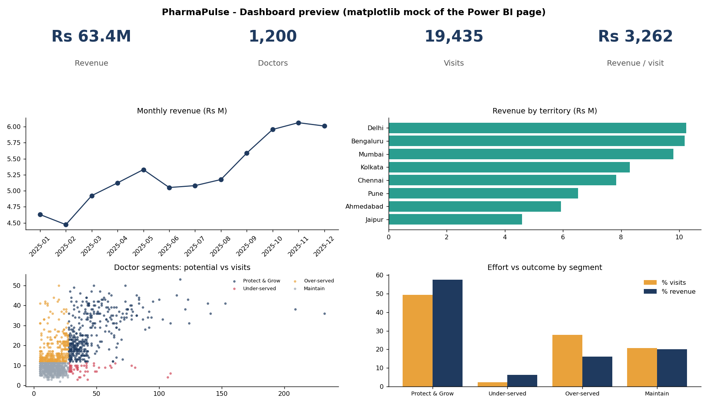

# PharmaPulse: Pharmaceutical Sales Analytics & Doctor Segmentation

Which doctors deserve more sales-rep time, and which are getting too much? PharmaPulse answers this with SQL, Python and Power BI on a synthetic pharma commercial dataset.



## Business questions
1. Which doctors, products and territories drive sales?
2. Is visit effort matched to doctor potential?
3. Who is over- or under-visited, and what should change?
4. How much revenue could a reallocation add?

## Key results
- Rs 63.4M revenue, 19,435 visits, 1,200 doctors; top 20% of doctors = 48.2% of revenue.
- 27.8% of visits go to "over-served" doctors producing 16.1% of revenue; 52 "under-served" high-potential doctors get 2.2% of visits.
- 60 high-potential doctors are in the lowest rep tier.
- Illustrative reallocation: about +0.9% revenue with zero extra visits (visit elasticity 0.14).

Full write-up: [reports/BUSINESS_RECOMMENDATIONS.md](reports/BUSINESS_RECOMMENDATIONS.md)

## Data
Synthetic, generated by `python/01_generate_data.py` (seed 42) so the project is fully reproducible. Six tables: territories, reps, products, doctors, visits, sales. Patterns (rep mis-tiering, diminishing returns, seasonality) are built in and documented in the script.

## Method
| Step | File | What it does |
|---|---|---|
| 1 | `python/01_generate_data.py` | Creates the dataset |
| 2 | `python/02_build_db.py` + `sql/*.sql` | Loads SQLite, runs 10 analyses (JOIN, CTE, CASE WHEN, LAG, RANK, NTILE, cumulative SUM) |
| 3 | `python/03_analysis_segmentation.py` | Doctor features, potential x engagement segmentation, KMeans cross-check, log-log visit-response model, reallocation simulation, charts, Power BI exports |
| 4 | `powerbi/DASHBOARD_GUIDE.md` | Star schema, DAX measures, 3-page layout |

Segments: Protect & Grow, Under-served, Over-served, Maintain. KMeans (k chosen by silhouette, k=3) is used as a data-driven sanity check; the rule-based matrix is the deliverable because the business can act on it.

## Run it
```
sh run_all.sh      # or run the three python files in order
```
Outputs: `data/pharmapulse.db`, `reports/sql_results/`, `reports/charts/`, `data/powerbi/`.

## Limitations
Synthetic data, CRM-estimated potential, correlational elasticity, no cost data. See the recommendations report.

## Repo layout
```
data/raw  data/powerbi  sql/  python/  powerbi/  reports/
```
